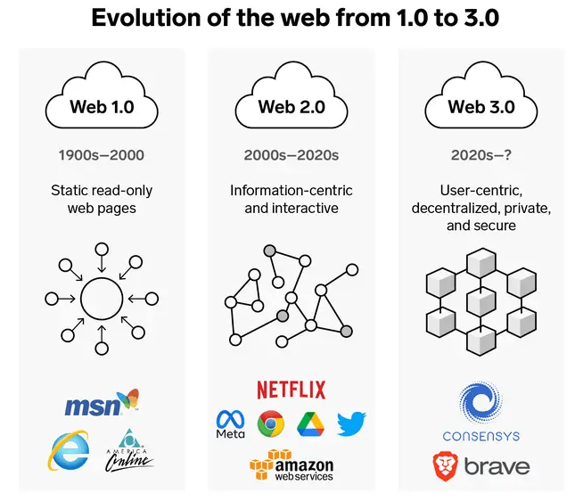
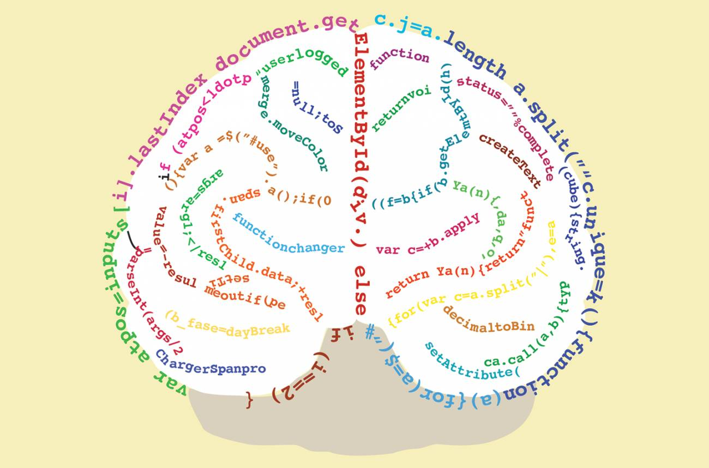
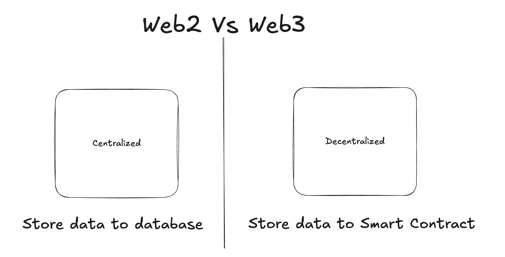
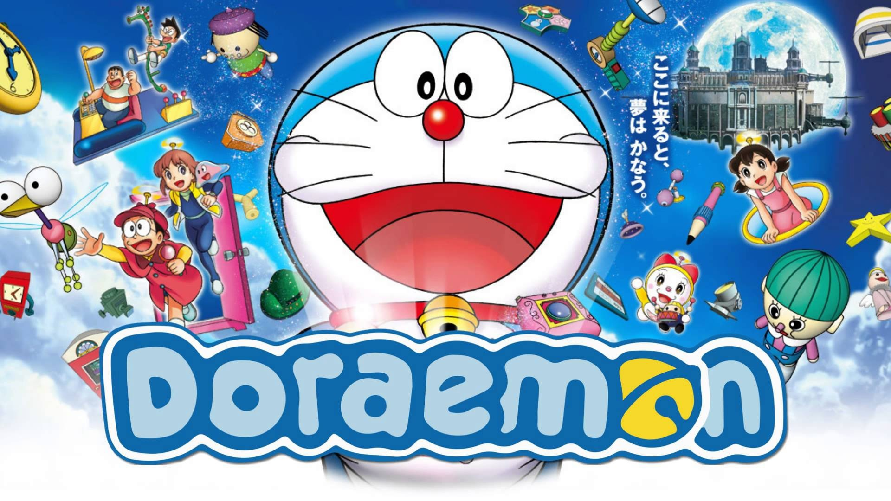
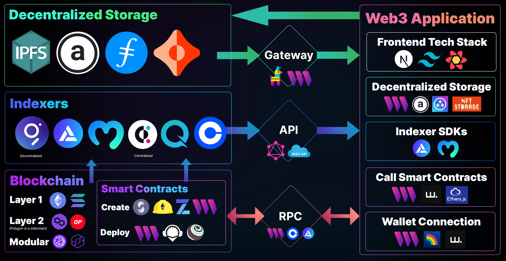

# fullstack-web3-roadmap



Halo gua Faisal dari ETH JKT, selamat datang di **Fullstack Web3 Dev Roadmap** Ethereum Jakarta. Repo ini gua buat sebagai panduan lengkap untuk kalian yang mau **zero to hero** menjadi Web3 developer.

Setelah gua speak di ETH JKT intro, ini adalah lanjutan journey kalian untuk belajar semua materi blockchain development. Journey ini panjang — karena repo ini fokus mulai dari fundamental yang kuat dan dibuat sedetail mungkin agar kalian menjadi Web3 developer yang berkualitas. Bisa dibilang ini kuliah online bareng ETH JKT.

> **Last Updated:** Maret 2026 — Sudah include update Pectra, Fusaka, EIP-8141, dan resource terbaru.

### ETHJKT Tower Course
Semua materi course lengkap dari Phase 0 sampai Phase 3 ada di repo **ETHJKT Tower Course**. Repo ini berisi study materials, arcane quests, quizzes, dan semua yang kalian butuhkan untuk menjalani roadmap ini secara terstruktur.

> [github.com/Ethereum-Jakarta/ethjkt-course](https://github.com/Ethereum-Jakarta/ethjkt-course) — ETHJKT Full Stack Web3 Developer Course: From Foundation to Blockchain

---

## Curated Learning Resources

Sebelum masuk ke roadmap, ini adalah kumpulan resource terbaik yang gratis dan berkualitas tinggi. Bookmark semua ini — kalian bakal bolak-balik pake sepanjang journey.

### Starter Kit — Mulai Dari Sini
| # | Resource | Link | Deskripsi |
|---|----------|------|-----------|
| 1 | **Ethereum.org Developer Docs** | [ethereum.org/developers/docs](https://ethereum.org/developers/docs/) | Dokumentasi resmi Ethereum Foundation — referensi utama untuk semua konsep Ethereum |
| 2 | **Cyfrin Updraft** | [updraft.cyfrin.io](https://updraft.cyfrin.io/courses) | Course gratis dari Patrick Collins: Blockchain Basics, Solidity, Foundry, Security Auditing (100k+ students) |
| 3 | **CryptoZombies** | [cryptozombies.io](https://cryptozombies.io/) | Tutorial interaktif gamified — belajar Solidity dengan bikin game zombie. Cocok banget buat pemula |
| 4 | **Solidity by Example** | [solidity-by-example.org](https://solidity-by-example.org/) | Kumpulan code snippet Solidity pendek dan jelas — reference cepat untuk belajar by reading code |

### Development Tools
| # | Resource | Link | Deskripsi |
|---|----------|------|-----------|
| 5 | **Remix IDE** | [remix.ethereum.org](https://remix.ethereum.org/) | IDE Solidity di browser, zero setup — cara paling cepat buat tulis dan test smart contract pertama |
| 6 | **Foundry Book** | [book.getfoundry.sh](https://book.getfoundry.sh/) | Dokumentasi Foundry (Forge, Cast, Anvil) — development toolkit standar industri sekarang |
| 7 | **Scaffold-ETH 2** | [scaffoldeth.io](https://scaffoldeth.io/) | Toolkit open-source buat rapid prototyping dApp — Foundry + Next.js + komponen Web3 siap pakai |
| 8 | **OpenZeppelin Wizard** | [wizard.openzeppelin.com](https://wizard.openzeppelin.com/) | Generator smart contract point-and-click — bikin ERC-20, ERC-721, Governor dengan library yang udah di-audit |

### Courses & Tutorials Lengkap
| # | Resource | Link | Deskripsi |
|---|----------|------|-----------|
| 9 | **Patrick Collins Full Course (YouTube)** | [youtube.com - Cyfrin Foundry](https://www.youtube.com/watch?v=-1GB6m39-rM) | Course 38+ jam gratis di freeCodeCamp — dari nol sampai advanced Solidity, Foundry, DeFi |
| 10 | **SpeedRunEthereum** | [speedrunethereum.com](https://speedrunethereum.com/) | Challenge hands-on: bikin NFT, DEX, dll pakai Scaffold-ETH. Selesaikan untuk dapet builder credential |
| 11 | **Alchemy University** | [alchemy.com/university](https://www.alchemy.com/university) | Bootcamp 7 minggu gratis — Solidity, Hardhat, fullstack dApp, ada sertifikat |
| 12 | **LearnWeb3 DAO** | [learnweb3.io](https://learnweb3.io/) | Platform gratis dengan track Freshman sampai Senior — Solidity, DeFi, NFT, DAO, L2 (110k+ devs) |
| 13 | **Web3 University (Alchemy)** | [web3.university](https://www.web3.university/) | Tutorial hub dengan "Road to Web3" — 10 minggu project-based learning |
| 14 | **Developer DAO Academy** | [academy.developerdao.com](https://academy.developerdao.com/) | Platform komunitas open-source buat belajar Web3 bareng |

### Security & Advanced
| # | Resource | Link | Deskripsi |
|---|----------|------|-----------|
| 15 | **Ethernaut (OpenZeppelin)** | [ethernaut.openzeppelin.com](https://ethernaut.openzeppelin.com/) | Wargame — setiap level adalah smart contract vulnerable yang harus kalian exploit. Wajib buat belajar security |
| 16 | **Damn Vulnerable DeFi** | [damnvulnerabledefi.xyz](https://www.damnvulnerabledefi.xyz/) | Challenge advanced: flash loan exploit, price manipulation, governance attack — training ground auditor |
| 17 | **RareSkills** | [rareskills.io](https://www.rareskills.io/) | Exercise gratis: gas optimization, EVM internals, ZK circuits — level up ke senior Web3 engineer |

### Reference & Discovery
| # | Resource | Link | Deskripsi |
|---|----------|------|-----------|
| 18 | **Solidity Official Docs** | [docs.soliditylang.org](https://docs.soliditylang.org/) | Referensi bahasa Solidity yang lengkap — syntax, types, inheritance, security considerations |
| 19 | **useWeb3** | [useweb3.xyz](https://www.useweb3.xyz/) | Aggregator kurasi resource Web3 terbaik — tutorials, courses, tools, boilerplate |
| 20 | **BlockDev ID** | [blockdev.id/knowledge](https://blockdev.id/knowledge) | Komunitas Web3 dev Indonesia — resource berbahasa Indonesia, newbie friendly |

### Recommended Learning Path
```
1. Mulai    → Ethereum.org Docs + Cyfrin Updraft Blockchain Basics
2. Code     → Remix IDE + CryptoZombies + Solidity by Example
3. Build    → Scaffold-ETH 2 + SpeedRunEthereum challenges
4. Deep     → Patrick Collins YouTube + Foundry Book
5. Security → Ethernaut + Damn Vulnerable DeFi
6. Level Up → RareSkills + Alchemy University
```

---

## Apa itu Fullstack Web3 Developer?

Full-stack Web3 Developer adalah developer yang mampu membangun aplikasi terdesentralisasi (DApp) secara menyeluruh, mulai dari frontend hingga smart contract blockchain.

Mari kita breakdown komponen-komponennya:

**"Full-stack" artinya:**
- Menguasai development Frontend (UI)
- Menguasai development Backend (server logic)
- Mampu mengintegrasikan keduanya

**"Web3" menambahkan kemampuan:**
- Development Smart Contract
- Integrasi dengan blockchain
- Pengelolaan data terdesentralisasi

**Tools dan Teknologi yang Digunakan:**

| Layer | Teknologi |
|-------|-----------|
| Frontend | React/Next.js, Tailwind, wagmi, viem, RainbowKit |
| Smart Contract | Solidity, Foundry (Forge/Cast/Anvil), OpenZeppelin |
| Backend | Node.js, Express, PostgreSQL, TheGraph, IPFS |
| Blockchain | Ethereum, L2s (Base, Arbitrum, Optimism), Testnets |
| Wallet | MetaMask, WalletConnect |

**Peluang Karir:**
- Web3 Developer ($80K-$200K/year remote)
- Smart Contract Engineer ($100K-$250K/year)
- Smart Contract Auditor ($150K-$400K/year)
- DeFi Protocol Developer
- Blockchain Protocol Engineer ($150K-$400K/year)

> Supply developer Web3 masih jauh di bawah demand. Dari Indonesia, hampir belum ada protocol-level contributor. Ini peluang besar.

---

## Phase 0 : Foundation — "The First Brick"


Phase 0 adalah pondasi dari segalanya. Tanpa pondasi yang kuat, bangunan apapun yang kalian bangun di atasnya pasti runtuh — dan itu termasuk karir Web3 kalian.

Di phase ini kalian belajar **programming dari nol** menggunakan JavaScript. Kenapa JavaScript? Karena 1 bahasa ini bisa handle frontend (website), backend (server), dan bahkan interaksi dengan blockchain lewat library seperti ethers.js dan viem. Daripada kalian belajar 3 bahasa berbeda, JavaScript mempercepat learning curve kalian secara signifikan.

**Koneksi ke Web3:** Semua yang kalian pelajari di sini langsung applicable di blockchain development nanti. Variable dan data types di JavaScript? Konsepnya sama persis di Solidity. Array dan Object? Mapping dan Struct di smart contract. Logic dan algorithm? Ini yang menentukan apakah smart contract kalian efisien atau boros gas fee. Git & GitHub? Semua project open-source Ethereum pakai Git — kalian ga bisa contribute tanpa ini.

Selain itu, di Phase 0 kalian juga mulai **menyicil teori blockchain** — belajar gimana network bekerja, apa itu consensus mechanism, dan kenapa kriptografi itu penting. Ini ga perlu dikuasain semua sekarang, tapi exposure awal ini bakal bikin Phase 3 nanti jauh lebih mudah dicerna.

> **Durasi estimasi:** 4-8 minggu (tergantung background kalian)

*Untuk yang NON IT dan baru pertama kali menyentuh programming:

📚 **Resources (NON IT INTRO):**
- [ETHJKT Phase 0 Preparation](https://github.com/Ethereum-Jakarta/phase-0-preparation) — Persiapan sebelum mulai Phase 0
- [ETHJKT Code in Mobile](https://github.com/Ethereum-Jakarta/phase-0-code-in-mobile) — Belajar coding dari HP
- [Introduction to Programming and Computer Science - FreeCodeCamp](https://www.youtube.com/watch?v=zOjov-2OZ0E)
- [100+ Computer Science Concepts Explained - Fireship](https://www.youtube.com/watch?v=-uleG_Vecis)
- [CS50: Introduction to Computer Science - Harvard](https://cs50.harvard.edu/x/)

### Learn Basic Tools
- Set Up Node.js
- IDE (VS Code, dll)
- NPM
- GitHub
- Command line basics

📚 **Resources:**
- [Node.js Installation - GeeksForGeeks](https://www.geeksforgeeks.org/install-node-js-on-windows/)
- [Git Tutorial - GitHub Docs](https://docs.github.com/en/get-started/start-your-journey/hello-world)
- [Git Tutorial - PetaniKode (Bahasa Indonesia)](https://www.petanikode.com/tutorial/git/)
- [Command Line Cheatsheet - Codecademy](https://www.codecademy.com/article/command-line-commands)
- [Linux Command Cheatsheet - GeeksForGeeks](https://www.geeksforgeeks.org/linux-commands-cheat-sheet/)
- [VS Code Tips & Tricks - Official](https://code.visualstudio.com/docs/getstarted/tips-and-tricks)

### Javascript Foundation
- Algorithm & Pseudocode
- Variable, Conditional Statements, Looping
- Function
- Data Structures (Array, Object)

📚 **Resources:**
- [Javascript Course - Sandhika Galih / WPU (Bahasa Indonesia)](https://www.youtube.com/watch?v=RUTV_5m4VeI&list=PLFIM0718LjIWXagluzROrA-iBY9eeUt4w)
- [Javascript Full Course - freeCodeCamp](https://www.freecodecamp.org/news/full-javascript-course-for-beginners/)
- [w3schools JavaScript](https://www.w3schools.com/js/)
- [Javascript Tutorial - PetaniKode (Bahasa Indonesia)](https://www.petanikode.com/tutorial/javascript/)
- [JavaScript.info - The Modern JavaScript Tutorial](https://javascript.info/)
- [Eloquent JavaScript (Free Book)](https://eloquentjavascript.net/)
- [ETHJKT Phase 0 Week 1 - Welcome to Code](https://github.com/Ethereum-Jakarta/phase-0-week1-welcome-to-code)
- [ETHJKT Phase 0 Week 2 - Array and Logic](https://github.com/Ethereum-Jakarta/phase-0-week2-array-and-logic)
- [ETHJKT Phase 0 Week 3 - Object is a Key](https://github.com/Ethereum-Jakarta/phase-0-week3-object-is-a-key)
- [ETHJKT Phase 0 Week 4 - Before the Journey](https://github.com/Ethereum-Jakarta/phase-0-week4-before-the-journey)

Latih logic kalian di competitive programming:
- [Codewars](https://www.codewars.com/) — target kyu 5/6
- [LeetCode](https://leetcode.com/) — mulai dari Easy
- [HackerRank](https://www.hackerrank.com/) — bagus buat interview prep

### Web2 Basics Development
- HTML & CSS
- JavaScript DOM & AJAX
- API Theory
- Build website pertama

📚 **Resources:**
- [HTML/CSS Course - WPU Sandhika Galih (Bahasa Indonesia)](https://www.youtube.com/@sandhikagalihWPU/courses)
- [HTML - w3schools](https://www.w3schools.com/html/)
- [CSS - w3schools](https://www.w3schools.com/css/)
- [CSS Flexbox Guide - CSS-Tricks](https://css-tricks.com/snippets/css/a-guide-to-flexbox/)
- [JavaScript DOM - w3schools](https://www.w3schools.com/js/js_htmldom.asp)
- [API Theory - AWS](https://aws.amazon.com/id/what-is/api/)
- [freeCodeCamp Responsive Web Design](https://www.freecodecamp.org/learn/2022/responsive-web-design/)

### Blockchain Theory
- Blockchain architecture
- Consensus mechanisms (PoW, PoS)
- Public vs private blockchains
- Cryptographic primitives & digital signatures

📚 **Resources:**
- [Ethereum Documentation (Official)](https://ethereum.org/en/developers/docs/)
- [Bitcoin Documentation](https://developer.bitcoin.org/)
- [Whiteboard Crypto (YouTube)](https://www.youtube.com/@WhiteboardCrypto) — sangat interaktif dan mudah dimengerti untuk pemula
- [Blockchain Knowledge - BlockDevID (Bahasa Indonesia)](https://blockdev.id/knowledge)
- [Crypto Hash - GeeksForGeeks](https://www.geeksforgeeks.org/cryptography-hash-functions/)
- [3Blue1Brown - But how does bitcoin actually work?](https://www.youtube.com/watch?v=bBC-nXj3Ng4)
- [Anders Brownworth - Blockchain Visual Demo](https://andersbrownworth.com/blockchain/)
- [Mastering Ethereum (Free Book)](https://github.com/ethereumbook/ethereumbook)

> Blockchain theory ini panjang. Boleh dicicil selama Phase 0-2. Habbit yang bagus: sering baca transaction hash di Etherscan. Kalian bakal sering manage Tx hash sebagai Web3 dev.

### Phase 0 Goals
- [ ] JS Codewars kyu 5/6 — buktiin logic kalian udah solid
- [ ] GitHub: commits, collaboration, resolve conflicts — ini skill wajib di dunia open-source Ethereum
- [ ] Web2 apps menggunakan DOM — kalian harus bisa manipulasi UI sebelum belajar connect ke wallet
- [ ] Pemahaman dasar blockchain — tau apa itu block, transaction, hash, wallet, dan consensus
- [ ] Punya MetaMask dan pernah kirim testnet transaction — mulai biasain interact dengan blockchain

> **Setelah Phase 0:** Kalian punya pondasi programming yang kuat dan sudah mulai familiar dengan konsep blockchain. Kalian belum bisa ngoding smart contract, tapi kalian tau gimana blockchain bekerja dan kenapa itu penting. Ini cukup untuk move ke Phase 1.

---

## Phase 1 : Backend Development (Web2) — "The Engine Room"


Banyak orang yang pengen jadi Web3 developer langsung loncat ke Solidity tanpa paham backend. Ini kesalahan fatal. Kenapa? Karena **smart contract itu pada dasarnya adalah backend** — logic, data storage, authentication, state management — semuanya ada di smart contract. Kalau kalian ga paham prinsip backend, kalian ga bakal bisa nulis smart contract yang proper.

Di Phase 1, kalian belajar backend development menggunakan Node.js dan Express. Kalian bakal bikin REST API, manage database, implement authentication, dan deploy services ke cloud. Ini skill yang langsung transferable ke Web3.

**Koneksi ke Web3:** Setiap konsep backend yang kalian pelajari di sini punya padanan langsung di blockchain development:
- **Database (PostgreSQL/MongoDB)** → Di Web3, blockchain itu sendiri adalah "database" kalian. Tapi banyak dApp juga butuh off-chain database untuk data yang ga perlu on-chain (metadata, user preferences, caching). Tools seperti TheGraph dan indexers juga pakai konsep database.
- **REST API** → Di Web3, kalian interact dengan blockchain lewat **RPC endpoints** — konsepnya mirip API call. Kalian juga butuh backend API untuk serve data ke frontend dApp kalian.
- **Authentication (JWT)** → Di Web3, authentication diganti dengan **wallet signature verification** (Sign-In with Ethereum / SIWE). Konsep cryptographic verification ini jauh lebih powerful dari JWT.
- **Cloud Deployment** → Smart contract di-deploy ke blockchain, tapi frontend dan indexer kalian tetap perlu cloud hosting. Railway, Vercel, dan IPFS jadi tools deployment kalian nanti.
- **Algorithm & Logic** → Gas optimization di Solidity itu 100% soal algorithm. Semakin efisien logic kalian, semakin murah transaksi smart contract.

> **Durasi estimasi:** 5-8 minggu

### Enhance Logic
- Clean Code
- Time Complexity
- Algoritma lanjutan (Searching, Sorting, Dijkstra, Hashing)
- OOP Konsep

📚 **Resources:**
- [ETHJKT Phase 1 Week 1 - Enhance Logic](https://github.com/Ethereum-Jakarta/phase-1-week1-enhance-logic)
- [Top Algorithms for Interviews - GeeksForGeeks](https://www.geeksforgeeks.org/top-10-algorithms-in-interview-questions/)
- [Clean Code JavaScript Tips](https://github.com/ryanmcdermott/clean-code-javascript)
- [Big-O Cheat Sheet](https://www.bigocheatsheet.com/)
- [NeetCode - Algorithm Roadmap](https://neetcode.io/roadmap)

### Backend API
- RESTful APIs
- Express.js / Node.js
- Database (PostgreSQL / MongoDB)
- Authentication & Security
- Backend testing

📚 **Resources:**
- [ETHJKT Phase 1 Week 2 - Backend Fundamental](https://github.com/Ethereum-Jakarta/phase-1-week2-backend-fundamental)
- [ETHJKT Phase 1 Week 3 - Backend Database](https://github.com/Ethereum-Jakarta/phase-1-week3-backend-database)
- [ETHJKT Phase 1 Week 4 - Backend API](https://github.com/Ethereum-Jakarta/phase-1-week4-backend-api)
- [ETHJKT Phase 1 Week 5 - Backend Advance](https://github.com/Ethereum-Jakarta/phase-1-week5-backend-advance)
- [REST API in Node.js - GeeksForGeeks](https://www.geeksforgeeks.org/what-is-rest-api-in-node-js/)
- [Node.js & Express Crash Course - freeCodeCamp](https://www.youtube.com/watch?v=Oe421EPjeBE)
- [Node.js for Beginners - Fireship](https://www.youtube.com/watch?v=ENrzD9HAZK4)
- [Prisma ORM Quickstart](https://www.prisma.io/docs/getting-started/quickstart)
- [PostgreSQL Tutorial](https://www.postgresqltutorial.com/)

### Cloud Deployment
- Cloud Services (IaaS, PaaS, SaaS)
- Deploy Backend Services
- CI/CD basics

📚 **Resources:**
- [What is Cloud Computing - AWS](https://aws.amazon.com/what-is-cloud-computing/)
- [Deploy Node.js to Vercel - GeeksForGeeks](https://www.geeksforgeeks.org/how-to-deploy-node-backend-on-vercel/)
- [Railway Docs](https://docs.railway.app/)
- [Vercel Docs](https://vercel.com/docs)
- [GitHub Actions Quickstart](https://docs.github.com/en/actions/quickstart)

### Phase 1 Goals
- [ ] Mastering Algorithm — solve LeetCode Medium problems, ini nanti jadi basis gas optimization di Solidity
- [ ] Database Design (ERD, business logic) — pola pikir ini sama persis saat kalian design smart contract storage
- [ ] Backend Development (REST API) — kalian bakal bikin API lagi di Web3 untuk serve off-chain data ke dApp
- [ ] Deploy Backend Services — pahami deployment flow, nanti kalian deploy smart contract dengan prinsip yang sama
- [ ] Understand HTTP, request/response cycle, status codes — ini fondasi interaksi dengan blockchain RPC

> **Setelah Phase 1:** Kalian udah bisa kerja sebagai backend developer di Web2. Skill kalian di algorithm, database, dan API design bakal jadi senjata rahasia waktu nulis smart contract yang efisien dan well-structured di Phase 3 nanti.

---

## Phase 2 : Front End World (6 Weeks) — "The Bridge to Web3"


> **Total: 45+ study materials, 21+ arcane quests, 6+ quizzes across 6 weeks**

Phase 2 adalah fase paling transformatif dalam journey kalian. Di sini kalian bukan cuma belajar React dan frontend modern — kalian belajar **cara menghubungkan user dengan teknologi**. Dan di Web3, frontend adalah satu-satunya cara user berinteraksi dengan smart contract kalian.

Bayangkan: smart contract kalian sudah perfect, udah di-audit, gas-efficient. Tapi tanpa frontend yang bagus, ga ada yang bisa pakainya. Setiap dApp yang sukses — Uniswap, OpenSea, Aave — sukses karena frontend mereka bikin interaksi blockchain jadi seamless. **Frontend adalah gerbang masuk ke blockchain.**

Di phase ini kalian belajar React ecosystem secara mendalam: dari basic components sampai advanced state management, dari simple API calls sampai real-time WebSocket. Dan di akhir phase, kalian mulai **integrasi Web3 pertama kalian** — connect wallet, read smart contract, send transaction.

**Koneksi ke Web3:** Phase 2 secara literal adalah bridge ke Web3 development:
- **React Components & Hooks** → Library Web3 seperti **wagmi** dan **RainbowKit** semuanya React-based. Custom hooks yang kalian belajar di sini? Di Web3 kalian bikin custom hooks untuk interact dengan smart contract (`useContractRead`, `useContractWrite`).
- **State Management (Zustand, React Query)** → Di dApp, kalian manage blockchain state (balance, transaction status, contract data) persis pakai pattern yang sama. React Query bahkan dipakai wagmi di belakang layar.
- **API Integration (Axios, fetch)** → Di Web3, "API" kalian adalah blockchain RPC. Kalian fetch data dari smart contract, listen event, dan submit transaction — semua pakai pattern yang sama seperti REST API call.
- **WebSocket** → Blockchain events pakai WebSocket subscription. Kalian bisa listen real-time ketika ada swap, transfer, atau mint di smart contract kalian.
- **Authentication (JWT)** → Di Web3, authentication diganti **wallet connection**. User ga perlu username/password — mereka connect MetaMask dan sign message. Library seperti wagmi handle ini semua.
- **Testing (Vitest, Playwright)** → Di Web3 kalian test smart contract dengan Foundry, dan test frontend integration dengan tools yang sama.
- **CI/CD & Deployment** → dApp frontend di-deploy ke Vercel/IPFS, smart contract ke blockchain. Pipeline-nya mirip.

> **Durasi:** 6 minggu intensif (dengan study material lengkap di setiap repo)

### Week 1 : Frontend Basic (HTML/CSS/jQuery)
[Repo: phase-2-week1-frontend-basic](https://github.com/Ethereum-Jakarta/phase-2-week1-frontend-basic)
- HTML structure, CSS Flexbox & Grid, jQuery, Local Storage, deploy Vercel

### Week 2 : React.js
[Repo: phase-2-week2-reactjs](https://github.com/Ethereum-Jakarta/phase-2-week2-reactjs)
- Components, Props, State, Hooks, Tailwind CSS, React Router

📚 Resources: [React Crash Course - Traversy Media](https://www.youtube.com/watch?v=LDB4uaJ87e0) | [Tailwind CSS - WPU](https://www.youtube.com/watch?v=z3slaXqmkT0&list=PLFIM0718LjIUHFRMzPJ0wGjx9_NlC5d1h) | [React Official Tutorial](https://react.dev/learn)

### Week 3 : Advanced Frontend
[Repo: phase-2-week3-frontend-advance](https://github.com/Ethereum-Jakarta/phase-2-week3-frontend-advance)
> 16 study materials, 5 quests, 3 quizzes
- Vite, Advanced Hooks, Custom Hooks, React Performance, TanStack (Query/Router/Table/Form), Redux Toolkit, Cypress, Stripe & Clerk

📚 Resources: [Next.js Learn](https://nextjs.org/learn) | [10 React Hooks Explained - Fireship](https://www.youtube.com/watch?v=TNhaISOUy6Q) | [TanStack Query Docs](https://tanstack.com/query/latest)

### Week 4 : State Management & API Integration
[Repo: phase-2-week4-state-and-api](https://github.com/Ethereum-Jakarta/phase-2-week4-state-and-api)
> 15 study materials, 5 quests, 3 quizzes
- Zustand, Data Fetching, Axios, React Query CRUD, JWT Auth, Protected Routes, WebSocket, Error Handling

### Week 5 : Fullstack Capstone (Individual)
[Repo: phase-2-week5-fullstack-capstone](https://github.com/Ethereum-Jakarta/phase-2-week5-fullstack-capstone)
> 12 study materials, 4 quests
- Project Planning, Fullstack Architecture, Testing (Vitest + Playwright), CI/CD, Deploy (Vercel + Railway), Monitoring (Sentry)

### Week 6 : Group Capstone + Demo Day
[Repo: phase-2-week6-group-capstone](https://github.com/Ethereum-Jakarta/phase-2-week6-group-capstone)
- Team Git, Code Standards, Group Project (WebSocket, RBAC, Admin Panel, File Uploads)
- **Demo Day** di Discord "Magic Temple" voice channel

### Web3 Basic Integration
Ini momen yang kalian tunggu — **pertama kalinya kodingan kalian berinteraksi dengan blockchain**. Di stage ini kalian belajar connect wallet ke website, read data dari smart contract, dan kirim transaksi. Semua skill React yang kalian bangun selama 5 minggu sebelumnya langsung applicable di sini. Kalian bakal bikin simple dApp — website yang bisa connect MetaMask, tampilkan balance, dan interact dengan smart contract di testnet.

📚 **Resources:**
- [wagmi Docs (React Hooks for Ethereum)](https://wagmi.sh/)
- [viem Docs (TypeScript Ethereum Interface)](https://viem.sh/)
- [RainbowKit (Wallet Connect UI)](https://www.rainbowkit.com/)
- [web3.js Docs](https://docs.web3js.org/)
- [ethers.js Docs](https://docs.ethers.org/)
- [Dapp Crash Course Playlist](https://www.youtube.com/watch?v=t3wM5903ty0&list=PLS5SEs8ZftgXlCGXNfzKdq7nGBcIaVOdN)

### Phase 2 Goals
- [ ] Fullstack Development — bikin aplikasi lengkap (frontend + backend) dari nol sampai deploy
- [ ] Advanced Hooks, TanStack, State Management — ini pondasi untuk manage blockchain state di dApp nanti
- [ ] Testing & CI/CD Pipeline — quality assurance, sama pentingnya di Web3 (smart contract bug = kehilangan uang)
- [ ] Group collaboration & code review — open-source Ethereum butuh skill ini, semua contribution lewat PR review
- [ ] Web3 Integration — connect wallet, read contract, send transaction. Ini "hello world" Web3 kalian
- [ ] **Cari pengalaman kerja sebagai programmer** (WAJIB sebelum Phase 3)

> **Setelah Phase 2:** Kalian udah bisa kerja sebagai fullstack developer Web2 dan udah punya first touch dengan blockchain. Ini titik krusial — **kalian harus cari pengalaman kerja real** sebagai programmer. Ambil 1-2 tahun pengalaman di industri sambil terus belajar Web3 di samping. Kenapa? Karena pengalaman kerja real ngajarin kalian hal yang ga bisa dipelajari dari tutorial: deadline pressure, code review dari senior, debugging production issues, dan kerja dalam tim. Semua ini bikin kalian jadi Web3 developer yang jauh lebih mature di Phase 3.
>
> Jadi sambil kerja, kalian sambil belajar blockchain theory, eksperimen dengan smart contract di Remix, dan ikut hackathon. Ketika Phase 3 selesai dan kalian merasa siap, baru pindah ke Web3 career.

---

## Phase 3 : Fullstack Web3 Developer — "Tower of Chains"


Inilah phase yang kalian tunggu-tunggu sejak awal. **Tower of Chains** — tempat dimana semua skill yang kalian bangun dari Phase 0 sampai Phase 2 akhirnya bergabung menjadi satu kekuatan: **kemampuan membangun aplikasi terdesentralisasi dari nol.**

Di Phase 3, kalian belajar **Solidity** — bahasa pemrograman untuk menulis smart contract di Ethereum. Tapi ini bukan belajar bahasa baru dari nol. Kalian udah punya fondasi JavaScript (Phase 0), pemahaman backend logic dan database (Phase 1), dan kemampuan integrasi frontend-to-blockchain (Phase 2). Solidity akan terasa familiar — syntax-nya mirip JavaScript, konsep storage-nya mirip database, dan pattern-nya mirip backend API yang kalian udah kuasai.

Yang membedakan Phase 3 dari phase sebelumnya: **di sini, bug bisa berarti kehilangan uang beneran.** Smart contract yang sudah di-deploy ke mainnet ga bisa di-edit. Ga ada `git revert`. Ga ada rollback. Kalau ada vulnerability, hacker bisa drain semua dana dalam hitungan detik. Ini kenapa security bukan optional — ini wajib. Dan ini kenapa kalian butuh fondasi yang kuat dari Phase 0-2 sebelum sampai di sini.

**Apa yang membuat Phase 3 special:**
- Kalian belajar pakai **Foundry** — development toolkit standar industri yang dipakai oleh tim-tim top seperti Uniswap, OpenSea, dan Aave. Foundry ini Rust-based, super cepat, dan powerful untuk testing.
- Kalian implement **token standards** (ERC-20, ERC-721, ERC-1155) yang jadi building blocks seluruh ekosistem DeFi dan NFT.
- Kalian bikin **DeFi primitives** — staking contract, simple AMM — dan connect semuanya ke frontend React dari Phase 2.
- Kalian belajar **security auditing** — gimana caranya nyerang smart contract dan gimana caranya defend. Skill ini alone bisa dapet kerjaan $150K+/year.
- Phase 3 ditutup dengan **hackathon simulation** — 48 jam bikin dApp dari nol dalam tim, persis kayak hackathon beneran di ETHGlobal.

**Koneksi ke semua yang udah kalian pelajari:**
- JavaScript logic (Phase 0) → Solidity logic, gas-efficient algorithm
- Backend patterns (Phase 1) → Smart contract architecture, storage design, state management
- React frontend (Phase 2) → dApp frontend pakai wagmi + viem + RainbowKit
- Database design (Phase 1) → On-chain storage layout, mapping/struct design
- API integration (Phase 2) → Contract interaction, event listening, transaction handling
- Testing (Phase 2) → Foundry testing, fuzz testing, exploit testing
- Deployment (Phase 1-2) → Smart contract deployment ke testnet dan mainnet

> **Durasi:** 5 minggu intensif. Setiap minggu ada study material, arcane quests, dan quizzes di repo tersendiri.

### Smart Contract Development (Solidity)
Solidity adalah bahasa pemrograman untuk menulis smart contract di Ethereum dan semua EVM-compatible chain (Polygon, Arbitrum, Base, Optimism, dll). Kalau kalian kuasai Solidity, kalian bisa build di **semua** chain ini — bukan cuma Ethereum.

- Data types, functions, modifiers
- Contract inheritance, events, custom errors
- Storage vs memory vs calldata — ini konsep unik blockchain yang menentukan gas cost
- Gas optimization — setiap operasi di blockchain ada biayanya, kalian harus belajar bikin code yang efisien

📚 **Resources:**
- [Cyfrin Updraft - Solidity Fundamentals](https://updraft.cyfrin.io/courses/solidity)
- [Cyfrin Updraft - Foundry Fundamentals](https://updraft.cyfrin.io/courses/foundry)
- [CryptoZombies](https://cryptozombies.io/)
- [Solidity by Example](https://solidity-by-example.org/)
- [Solidity Official Docs](https://docs.soliditylang.org/)
- [Foundry Book](https://book.getfoundry.sh/)
- [OpenZeppelin Contracts Docs](https://docs.openzeppelin.com/contracts/5.x/)
- [Remix IDE](https://remix.ethereum.org/)
- [LevelUp - Scroll (Bahasa Indonesia)](https://www.levelup.xyz/solidity)
- [SmartContract Full Course (GitHub)](https://github.com/smartcontractkit/full-blockchain-solidity-course-py)

### Mastering dApp Development
Di stage ini kalian menggabungkan semuanya — smart contract yang udah kalian tulis di-connect ke frontend React yang udah kalian kuasai di Phase 2. Ini dimana kalian benar-benar merasakan flow development Web3 secara end-to-end: user connect wallet → interact dengan UI → frontend call smart contract → transaction confirmed on-chain → UI update real-time.

**Frontend Integration:**
- wagmi + viem + RainbowKit — trifecta library Web3 frontend modern
- Transaction management & event listening — UX harus smooth walaupun transaction butuh 12 detik untuk confirmed
- Error handling & UX best practices — handle rejected transaction, insufficient gas, network switch

**Backend Services:**
- IPFS integration — storage terdesentralisasi untuk file/metadata NFT
- TheGraph & Subgraphs — indexing blockchain data agar queryable (ga mungkin kalian query seluruh blockchain tiap kali user buka halaman)
- Chainlink Oracles — data dari luar blockchain (harga token, data real-world) yang bisa diakses smart contract
- Off-chain data management — ga semua data harus on-chain, kalian perlu tau kapan pakai database biasa vs blockchain

**Smart Contract Patterns:**
- ERC standards (ERC-20, ERC-721, ERC-1155) — token standards yang jadi fondasi seluruh ekosistem DeFi dan NFT
- Upgradeable contracts (Proxy patterns) — cara update smart contract yang udah di-deploy (karena smart contract immutable by default)
- Access control patterns — siapa boleh manggil function apa, penting banget buat security
- Gas optimization patterns — bikin contract lebih murah untuk dipakai user

📚 **Resources:**
- [Scaffold-ETH 2](https://scaffoldeth.io/) — rapid prototyping toolkit
- [SpeedRunEthereum](https://speedrunethereum.com/) — hands-on challenges
- [OpenZeppelin Wizard](https://wizard.openzeppelin.com/) — generate token contracts
- [Chainlink Docs - Data Feeds](https://docs.chain.link/data-feeds)
- [TheGraph Docs](https://thegraph.com/docs/)
- [IPFS Docs](https://docs.ipfs.tech/)
- [DeFi Developer Road Map (GitHub)](https://github.com/OffcierCia/DeFi-Developer-Road-Map)
- [Whiteboard Crypto (YouTube)](https://www.youtube.com/@WhiteboardCrypto)
- [Patrick Collins - Cyfrin Updraft Advanced Foundry](https://updraft.cyfrin.io/courses/advanced-foundry)

### Security & Auditing
Skill paling dicari dan paling dibayar mahal di industri Web3. Smart contract auditor bisa dapet $150K-$400K/year — dan supply-nya masih sangat sedikit. Di stage ini kalian belajar gimana hacker menyerang smart contract (reentrancy, flash loan exploit, price manipulation) dan gimana cara defend. Kalian bakal exploit vulnerable contracts sendiri — karena cara terbaik belajar defend adalah dengan belajar attack dulu.

📚 **Resources:**
- [Cyfrin Updraft - Security & Auditing](https://updraft.cyfrin.io/courses/security)
- [Ethernaut](https://ethernaut.openzeppelin.com/) — wargame security challenges
- [Damn Vulnerable DeFi](https://www.damnvulnerabledefi.xyz/) — advanced exploit challenges
- [SWC Registry](https://swcregistry.io/) — database vulnerability patterns
- [Slither (Static Analyzer)](https://github.com/crytic/slither)
- [RareSkills - Gas Optimization](https://www.rareskills.io/post/gas-optimization)
- [Solidity Patterns](https://fravoll.github.io/solidity-patterns/)

### Portfolio Project Ideas
Wajib bikin minimal 2-3 project ini untuk portfolio:

- **Basic dApp** — Smart contract + wallet integration + basic transactions
- **NFT Marketplace** — ERC-721/1155, marketplace, IPFS metadata
- **DeFi Application** — Token swapping, liquidity, yield farming
- **DAO Platform** — Governance token, voting mechanism, treasury
- **Staking dApp** — Deposit, reward calculation, claim rewards, frontend

### Phase 3 Goals
- [ ] Write, test, deploy smart contracts dengan Foundry — kalian harus bisa dari nulis sampai deploy sendiri
- [ ] Implement ERC-20, ERC-721, ERC-1155 — building blocks seluruh ekosistem DeFi dan NFT
- [ ] Build DeFi primitives (staking, AMM) — pahami mekanisme yang menggerakkan miliaran dolar di DeFi
- [ ] Security auditing basics — selesaikan Ethernaut, jalanin Slither, tulis audit report
- [ ] Gas optimization — bikin contract kalian murah dan efisien
- [ ] Complete dApp (contracts + frontend + deployment) — portfolio piece utama kalian
- [ ] Hackathon simulation — 48 jam bikin dApp dari nol, experience beneran kayak ETHGlobal
- [ ] **Siap apply kerja Web3 dan menang hackathon**

> **Setelah Phase 3:** Kalian adalah **Fullstack Web3 Developer**. Kalian bisa nulis smart contract, bikin frontend dApp, deploy ke mainnet, dan punya portfolio yang solid. Kalian siap apply ke posisi Web3 developer, ikut hackathon, dan mulai contribute ke open-source Ethereum. Buat yang mau lebih dalam lagi ke protocol-level engineering, ETHJKT punya track lanjutan: **The Black Tower** — inner circle untuk contribute langsung ke Ethereum protocol.

---

## Continuous Learning — "The Journey Never Ends"

Web3 adalah industri yang bergerak paling cepat di dunia teknologi. Ethereum alone udah ngeluarin 2 major upgrade di 2025 (Pectra & Fusaka), dan 2026 ada 2 lagi yang direncanakan (Glamsterdam & Hegota). Setiap upgrade membuka peluang baru, tools baru, dan cara baru untuk build. Sebagai Web3 developer, kalian harus terus belajar — bukan karena ilmu lama kalian jadi useless, tapi karena ada opportunity baru yang terus muncul.

Ini topik-topik yang harus kalian ikuti setelah Phase 3:

**Layer 2 & Scaling:**
- Rollups (Optimistic vs ZK)
- Data Availability (Blobs, PeerDAS)
- L2 economics

**DeFi Advanced:**
- AMM mechanics (Uniswap V4 Hooks)
- Flash loans
- MEV & Flashbots
- Cross-chain intents (ERC-7683)

**Ethereum Protocol (2025-2026 Updates):**
- Pectra upgrade (EIP-7702 Account Abstraction, blob increase)
- Fusaka upgrade (PeerDAS)
- EIP-8141 Frame Transactions
- Post-Quantum Security
- Glamsterdam & Hegota upcoming upgrades

**Stay Connected:**
- Follow Web3 blogs & newsletters
- Join Discord communities (ETH JKT, Ethereum R&D)
- Ikut hackathons (ETHGlobal, Devfolio)
- Contribute to open source
- Ikuti EIP updates di [eips.ethereum.org](https://eips.ethereum.org/)
- Baca research di [ethresear.ch](https://ethresear.ch/)

---

## Career & Community

### Job Hunting
- [web3.career](https://web3.career/)
- [crypto.jobs](https://crypto.jobs/)
- [ETHGlobal Showcase](https://ethglobal.com/)
- [RareSkills - Solidity Interview Questions](https://www.rareskills.io/post/solidity-interview-questions)

### Komunitas Indonesia
- [Ethereum Jakarta](https://github.com/Ethereum-Jakarta) — ETH JKT GitHub
- [BlockDev ID](https://blockdev.id/) — komunitas Web3 dev Indonesia terbesar

---

> *"Supply developer Web3 masih jauh di bawah demand. Kalian yang mulai sekarang adalah gelombang pertama dari Indonesia. Let's build."* — Faisal / Zexo, ETH JKT
